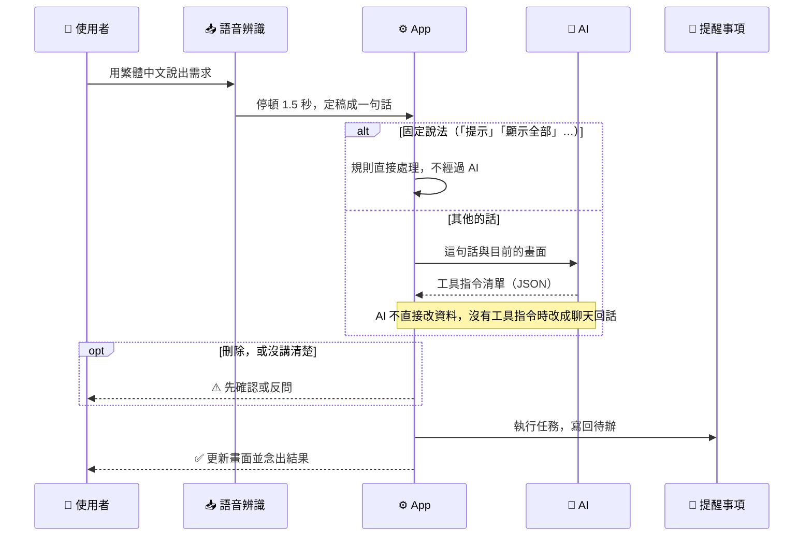

<p align="center">
  
</p>

# VoiceTodo

_用繁體中文說出需求，由 AI 理解意圖，再由 App 操作待辦清單：一個探索語音、LLM 與 GUI 如何互補的 iOS／macOS 實驗專案_

---

| 項目 | 內容 |
| --- | --- |
| 平台 | iOS 26.4、macOS 26.4 以上 |
| 語音輸入 | **僅支援繁體中文** |
| AI | Gemini API（雲端，預設）或 Apple Intelligence（裝置上），在設定中切換 |
| 待辦存放 | Apple 提醒事項，通知由提醒事項 App 跳出 |

## 📋 目錄

- [專案介紹](#-專案介紹)
- [功能](#-功能)
- [使用方式](#-使用方式)
- [開始使用](#-開始使用)
- [實作方式](#-實作方式)
- [驗證](#-驗證)
- [結論與未來展望](#-結論與未來展望)
- [第三方服務與資料](#-第三方服務與資料)

---

## 💡 專案介紹

未來的 App 也許不再需要複雜的操作介面，而是由一個 AI 小幫手介紹功能、理解需求，並協助使用者完成操作。這個專案結合繁體中文語音輸入、LLM 與 GUI，實際做出來驗證這種互動方式。

| 互動方式 | 適合 |
| --- | --- |
| **觸控 GUI** | 簡單操作、瀏覽與確認資訊、精確修改、不方便說話的時候 |
| **語音 + AI** | 一次描述多個操作、直接說出目標、不熟悉 App 時的功能探索 |

實際用下來，簡單操作還是觸控比較直覺。這個專案想知道的是：操作比較複雜，或使用者不熟悉 App 時，AI 能不能提供另一個更自然的入口。

---

## ✨ 功能

### 待辦操作

- 待辦事項新增、修改、設定完成、刪除與查詢，一句話可以包含多個操作
- 刪除前先確認；沒講清楚時反問
- 復原與重做
- 觸控操作與語音操作並存，看起來能點的都能點

### 回饋與引導

- 操作結果的語音回饋（可以開關）
- 提示頁：開場問候輪流顯示一頁提示，引導新手去問「提示」

### 額外能力

- 查天氣：只用說的，不改變待辦

---

## 🗣️ 使用方式

App 開啟後持續聆聽，用**繁體中文**描述想做的事即可，停頓約 1.5 秒算說完一句。

| 你可以說 | App 會 |
| --- | --- |
| 「明天下午三點開會」 | 新增一筆待辦 |
| 「第二項改到後天」 | 修改那一筆的日期 |
| 「明天會下雨嗎」 | 念出天氣，不改變待辦 |
| 「提示」 | 打開提示頁，看用法與範例 |

不知道怎麼說時，說「提示」或按工具列的提示按鈕。

---

## 🚀 開始使用

### 前置需求

| 工具 | 版本 | 為什麼 |
| --- | --- | --- |
| [Xcode](https://developer.apple.com/xcode/) | 26.4 以上 | App 的部署目標是 iOS 26.4／macOS 26.4，需要對應的 SDK；開發時使用 Xcode 27.1，沒有用 Xcode 26 測過 |
| Apple Developer 帳號 | 免費帳號即可 | 在實機上執行需要簽章 |
| [Gemini API key](https://aistudio.google.com/apikey) | — | 預設的 AI；只用 Apple Intelligence 時可以不用 |

確認 Xcode 版本：

```bash
xcodebuild -version
```

使用 Apple Intelligence 時，需要支援的裝置，並在系統設定中開啟 Apple Intelligence。

### 1. 取得程式碼

```bash
git clone https://github.com/zed201712/VoiceTodo.git
cd VoiceTodo
```

### 2. 設定簽章

用 Xcode 開啟 `voice_todo.xcodeproj`，在 target `voice_todo` 的 **Signing & Capabilities** 選擇自己的 Team；Bundle Identifier 衝突時換成自己的。

### 3. 執行

在 Xcode 選擇 **My Mac** 或 iOS 實體裝置，按 Run（⌘R）。語音辨識與提醒事項建議在實機上使用。

第一次啟動會要求麥克風、語音辨識、提醒事項的權限（查所在地的天氣時另外要求定位）。看到小精靈的開場問候，就代表 App 已經在聆聽。

### 4. 設定 AI

App 不附 API key：

1. 到 [Google AI Studio](https://aistudio.google.com/apikey) 建立 API key。
2. 打開 App 的設定，填入 key，按「測試連線」確認。

key 只存在裝置的 Keychain，不會寫進專案；也請不要把 key 提交到 Git。改用 Apple Intelligence 時，在 App 的設定把 AI 換成 Apple Intelligence。

<details>
<summary><strong>命令列建置與測試</strong></summary>

只確認 iOS 能編譯（不簽章、不啟動 Simulator）：

```bash
xcodebuild build -scheme voice_todo -destination 'generic/platform=iOS' CODE_SIGNING_ALLOWED=NO
```

在 macOS 上跑單元測試：

```bash
xcodebuild test -scheme voice_todo -destination 'platform=macOS' -only-testing:voice_todoTests
```

</details>

---

## ⚙️ 實作方式

AI 只負責理解意圖、產生指令；真正改變待辦的是 App 自己的程式。下圖是一句話從說出到完成的路徑：



| AI | 負責 |
| --- | --- |
| Gemini（預設） | 理解意圖、修正語音辨識的錯字、回答 App 以外的閒聊 |
| Apple Intelligence | 只負責理解意圖，在裝置上執行 |

兩個 AI 一次只用一個。程式裡也有 Ollama 的實作，目前在設定中未開放。架構與資料流見 [docs/overview.md](docs/overview.md)，各功能的行為見 [docs/specs/](docs/specs/)。

---

## 📊 驗證

同一份 33 句測試句（新增、查詢、修改、刪除、聊天、錯字與換說法），走 App 實際的路徑，比較兩個 AI 理解意圖的結果：

| AI | 執行位置 | 準確率 | 每句耗時 |
| --- | --- | --- | --- |
| Gemini（gemini-3.1-flash-lite） | 雲端 | **28/33** | 約 2～4 秒 |
| Apple Intelligence（macOS 27） | 裝置上 | 20/33 | 約 6 秒 |

測試環境：macOS 27.0.1、M1、8 GB 記憶體。Gemini 的準確率較高，所以是預設的 AI。測試句與做法見 [ai-alignment](docs/eval/ai-alignment.md)。

---

## 🔭 結論與未來展望

- 簡單操作：觸控介面直覺、方便，依然有明顯優勢。
- 複雜需求：使用者可以直接描述目標，不必自己拆解成一連串操作。
- 新手引導：當使用者不知道功能在哪裡，或不知道該怎麼操作時，可以直接詢問 App。

> **Voice 不取代 GUI，而是讓使用者多一種與 App 互動的方式。**

### 如果未來的 App 可以直接理解你的需求？

以下是概念上的使用情境，並非本專案已實作的跨 App 功能。

| 使用情境                                           | 傳統 GUI 操作                          | 未來的 Voice 互動                           |
| ---------------------------------------------- | ---------------------------------- | -------------------------------------- |
| **臨時通知朋友**<br />正準備出門，突然想起要告訴小明自己會晚點到。         | 開啟通訊 App → 找到小明 → 進入對話 → 輸入訊息 → 送出 | 說出「幫我傳訊息給小明：我晚一點到」→ AI 理解對象與內容 → 經使用者確認後送出 |
| **尋找不熟悉的功能**<br />打開銀行 App 想查看存款，卻不知道功能藏在哪個選單。 | 逐一瀏覽選單與頁面，尋找存款相關功能                 | 詢問「我的銀行存款在哪裡看？」→ AI 理解目的 → 移動到相關頁面      |

這些情境呈現了語音互動的另一種可能：**使用者不必先知道操作步驟或功能位置，而是可以從自己想完成的目標開始。**

---

## 🔌 第三方服務與資料

| 服務／資料 | 用途 | 授權與說明 |
| --- | --- | --- |
| [Gemini API](https://ai.google.dev/) | 理解使用者的話、產生工具指令與聊天 | 需要自己的 API key；適用 [Gemini API 條款](https://ai.google.dev/gemini-api/terms) |
| [Open-Meteo](https://open-meteo.com/) | 天氣預報 | 不用 key；資料授權 [CC BY 4.0](https://creativecommons.org/licenses/by/4.0/)，App 在顯示天氣的地方標示來源 |
| 內政部國土測繪中心 [鄉鎮市區界線](https://data.gov.tw/dataset/7441) | App 內建的鄉鎮市區邊界（由 `tools/make_towns.py` 產生，經過簡化） | [政府資料開放授權條款第 1 版](https://data.gov.tw/license) |
| Apple 系統框架 | 語音辨識、語音合成、Apple Intelligence、提醒事項、地名搜尋（MapKit）、定位 | 在裝置上執行或由系統提供 |

> [!WARNING]
> - Gemini 免費方案送出的內容可能被 Google 用來改善產品，請不要說出不想送出的個人資料。
> - Open-Meteo 的免費 API 只限**非商業用途**（見 [Terms](https://open-meteo.com/en/terms)）。
